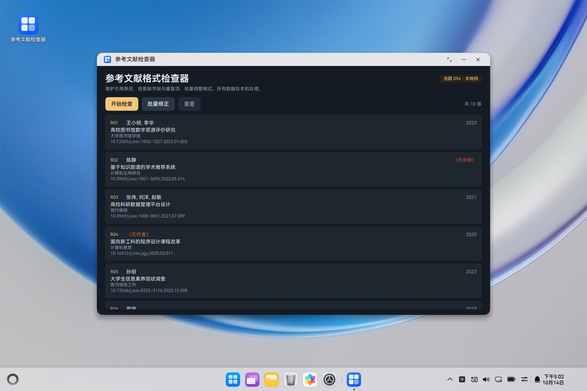
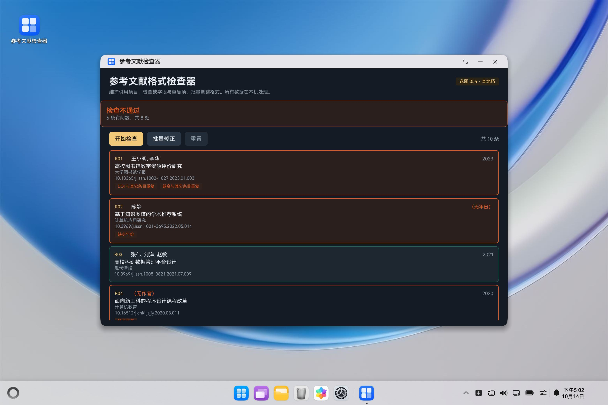
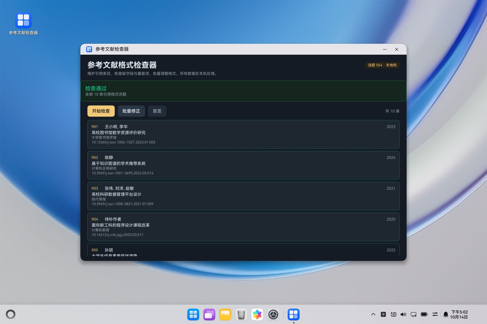

# 参考文献格式检查器 · 鸿蒙 PC 校园应用

> 选题 054 · 本地档 · ArkTS / ArkUI

一个运行在鸿蒙 PC（2in1）上的小工具：维护参考文献清单，逐条检查「缺字段」与「重复项」，支持批量修正，形成一个可演示的完整闭环。

## 功能

- **逐条检查** —— 作者 / 题名 / 期刊名 / 年份 / DOI 五个字段的完整性；年份必须是 4 位
- **重复检测** —— DOI 与题名在全清单内查重，重复的双方都会被标出
- **批量修正** —— 补占位值（`待补作者`、`2024`、`10.0000/pending.xxx`）、解开重复
- **判定结论** —— 「检查通过 / 检查不通过」，并给出问题条数与总处数

内置 10 条样例引用（其中 6 条存在问题、共 8 处），开箱即可演示完整流程。

## 演示

| 步骤 | 操作 | 画面 |
|---|---|---|
| ① | 打开应用 | 10 条引用，灰色边框 = 尚未检查 |
| ② | 点「开始检查」 | 红框：**检查不通过 · 6 条有问题，共 8 处** |
| ③ | 点「批量修正」 | 缺字段被补上（`待补作者`、`2024`…） |
| ④ | 再点「开始检查」 | 绿框：**检查通过 · 全部 10 条引用格式完整** |

| ① 初始 | ② 检查不通过 |
|---|---|
|  |  |

| ③ 批量修正后 | ④ 复查通过 |
|---|---|
|  |  |

> 截图为鸿蒙 2in1 模拟器实测。

## 技术要点

- **ArkTS + ArkUI**：`@Entry` / `@Component` / `@State` / `@Builder` / `ForEach`
- **本地档**：数据内置，不联网、不读文件系统、不需要账号
- **设备类型 `2in1`**（鸿蒙 PC / 平板二合一），`compatibleSdkVersion: 6.1.1(24)`
- 已验证：DevEco Studio 编译零错误；模拟器实机安装运行，全流程截图通过

## 运行

1. 用 DevEco Studio 打开本工程
2. 选择 2in1 模拟器（或真机）
3. 点绿色运行按钮

## 目录

```
entry/src/main/ets/pages/Index.ets    全部界面与逻辑（单文件）
entry/src/main/module.json5           模块配置（deviceTypes: ["2in1"]）
AppScope/                             应用级配置与资源
docs/接入说明.md                       判断规则、演示脚本、开发中踩过的坑
screenshots/                          四张演示截图
```

## 判断规则

| # | 规则 |
|---|---|
| 1 | 作者、题名、期刊名、DOI 任一为空 → 判「缺少」 |
| 2 | 年份为空 → 「缺少年份」；年份不是 4 位 → 「年份应为 4 位」 |
| 3 | DOI 在清单中出现多次 → 「DOI 与其它条目重复」 |
| 4 | 题名在清单中出现多次 → 「题名与其它条目重复」 |
| 5 | 全部条目无问题 → 「检查通过」；否则「检查不通过」并给出条数与处数 |
